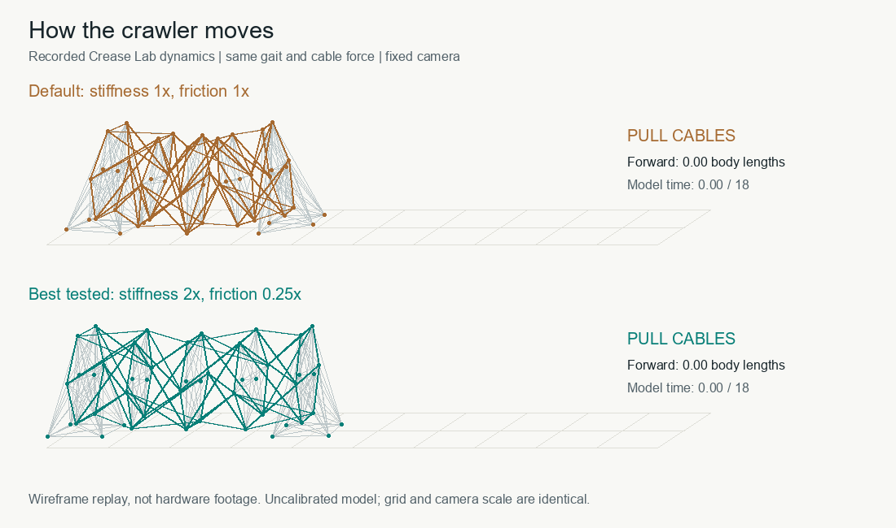
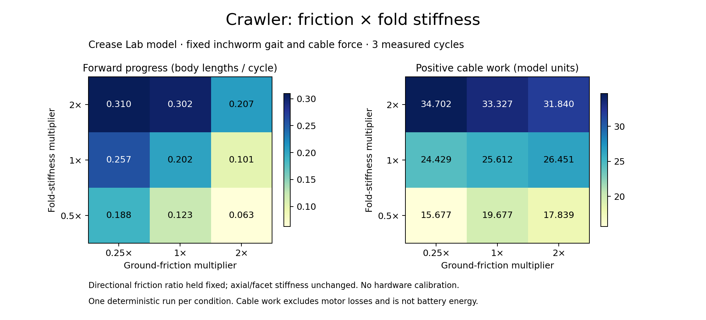

# Friction and fold-stiffness pilot

This separate experiment runs the supplied Crease Lab crawler dynamics,
not navigation-lab's geometric circles. Original source files are unchanged.
It is a sensitivity study of an uncalibrated model, not hardware validation.

## Run

Requires Node.js, Python with Matplotlib, and the supplied Crease Lab source
at `../crease-lab/web/{core,motion}.js`. Alternatively set `CREASE_LAB_DIR`
to its extracted directory. The supplied source is included at `../crease-lab`;
SHA-256 hashes
are recorded in `results/sweep.json` so results can be tied to the exact source.

```sh
node sweep.cjs
node --test test.cjs
python plot.py
node record.cjs
python animate.py
```

Python dependencies: Matplotlib and Pillow. On standard Python, install with
`python -m pip install matplotlib pillow`. MSYS2 users should use the matching
MSYS2 Python packages. The GIF renderer uses Arial or DejaVu Sans where available
and otherwise falls back to Pillow's default font.

`record.cjs` captures both comparison trajectories and checks their endpoints
against `results/sweep.json`. `animate.py` renders those actual node positions
to an 18-second GIF, not a screen recording or a learned-policy rollout.



## What changes

- Fold stiffness: 0.5×, 1×, 2× the model default 0.12. Axial stiffness (50)
  and facet stiffness (0.12) stay fixed. This is not a change in all body stiffness.
- Ground friction: 0.25×, 1×, 2× the directional coefficients (0.12 forward,
  1.2 backward, 0.8 sideways). The directional ratios stay fixed; this is not
  a calibrated mapping to specific surfaces.
- Four-cell default crawler; preset inchworm gait; fixed peak cable force 2.56.
  The source's automatic force increase with fold stiffness is deliberately
  not used. No learning or gait tuning occurs.
- Each condition settles for 1.5 model-time units, warms up for one 6-unit
  cycle, then measures three cycles (18 units). Conditions use the same 0.005
  timestep. All nine are repeated at 0.0025 for numerical sensitivity.

Friction is applied before settling and reapplied after each gait phase reset.
Progress is projected onto the post-warm-up heading and normalized by initial
body length. Work is positive cable shortening work only, not battery energy.
Maximum penetration and absolute axial bar strain include settling/warm-up;
length extrema and work refer to the measurement window. A completed run
only means finite numerical state, not a task success or physically valid design.

## Pilot findings



All nine parameter conditions completed. Forward progress ranged from 0.06265
to 0.30973 initial body lengths per cycle. The default condition gave 0.20180.
The largest progress in this small grid was at 2× fold stiffness and 0.25×
friction. Do not extrapolate an optimum outside this grid or to real materials.

Zero friction produced effectively zero horizontal center-of-mass displacement.
Without actuation, residual forward drift was 0.00001852 body lengths/cycle.
The maximum change in progress after halving the timestep was 0.00070825
body lengths/cycle. This is one numerical sensitivity check, not a proof of
convergence or model validity. There are no independent stochastic replicates.

The model uses gravity, penalty ground contact, directional friction impulses,
and bar/hinge elasticity. Ground penetration, large deformation, lack of verified
self-contact, idealized cables, and uncalibrated masses/materials limit physical
interpretation. Next steps: inspect deformation/contact diagnostics, test more
gaits and geometries, then compare to the team's agreed simulator/hardware.
